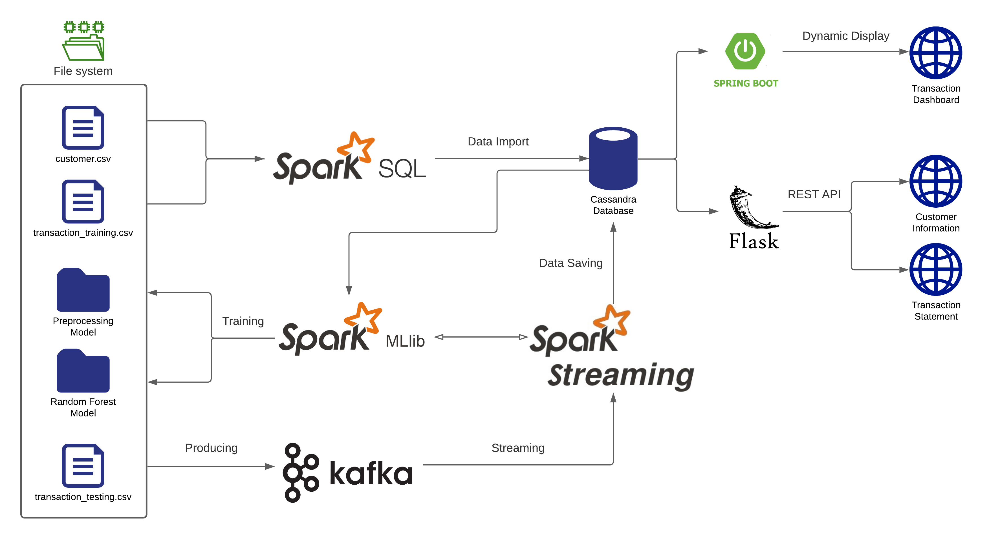
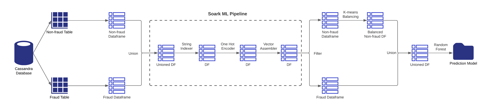
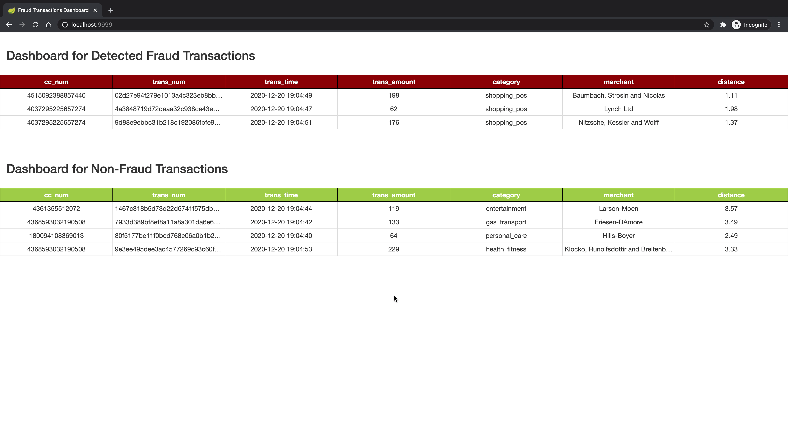
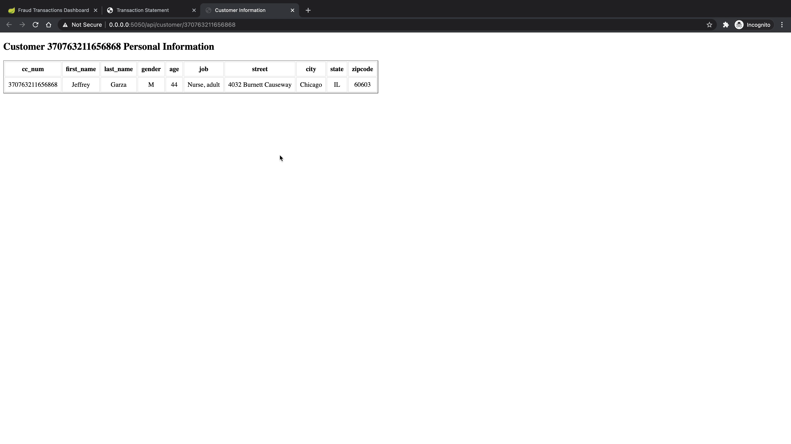
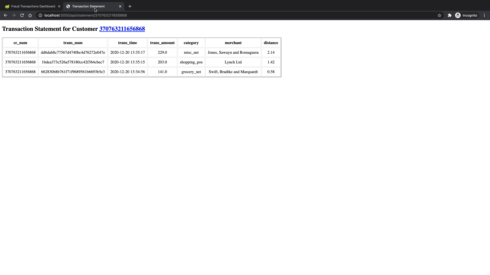

# Real-time Credit Card Fraud Detection Pipeline

## Workflow and Architecture

The following figure illustrates the workflow and architecture of the pipeline:



For setup, I simulate 100 customers' information and store it in the [`customer.csv`](./src/customer.txt) file, along with over 10K transaction records in the `transaction_training.csv` file. Then, a Spark SQL job retrieves the data and imports it into a Cassandra database. Next, a Spark ML job reads the data from Cassandra, trains on it, and creates the Preprocessing and Random Forest models to classify transaction records as fraudulent or not.

After the models are saved to the file system, a Spark Streaming job loads the ML models and consumes credit card transactions from Kafka. Create a Kafka topic and produce transaction records from the `transaction_testing.csv` file as messages for the Spark Streaming job to consume. The streaming job predicts whether these transactions are fraudulent and then saves them into the `fraud_transaction` and `non_fraud_transaction` tables separately based on the classification.

With classified incoming transaction records stored in the Cassandra database, the Spring Boot framework displays fraud and non-fraud transactions in real time on the dashboard web page. The Flask framework also provides two REST APIs to retrieve customer information and create transaction statements for each customer.

__A video demo for the workflow could be found here:__ https://youtu.be/fOVsxk16b0w

## Implementation Details

### Customers & Transactions dataset

Simulate 100 customers using [Mockaroo](https://www.mockaroo.com/). Each record includes the following columns (information):

- cc_num: credit card number which uniquely identifies each card/customer
- first: customer's first name
- last: customer's last name
- gender: customer's gender
- street
- city
- state
- zip: zip code for the address above
- lat: latitude for the address above
- long: longitude for the address above
- job: customer's vocation
- dob: the date of birth for the customer

Also generate over 10K transaction records for these customers using the same method. Each record includes the following columns (information):

- cc_num: credit card number which uniquely identifies each card/customer
- first: customer's first name
- last: customer's last name
- trans_num: transaction number
- trans_date: transaction date
- trans_time: transaction time
- unix_time: transaction time in Unix timestamp format
- category: category for the purchased item
- amt: transaction amount
- merchant: the place that the transaction happened
- merch_lat: latitude for the merchant
- merch_long: longitude for the merchant
- is_fraud: boolean to indicate whether the transaction is fraudulent

These transaction records are later used as the training set and testing set, with a splitting ratio of 80%.

### Spark ML job

First, run a Spark SQL job to retrieve the customer and transaction training data and import them into the Cassandra database. When importing the transaction data, the job also calculates two extra features, `age` and `distance`. `age` is the age of each customer at the time the data are imported, based on their date of birth. `distance` is the distance between the customer's address and the merchant's address, calculated as the Euclidean distance between the two places using the latitude and longitude information. All the training data, including the two extra features, are split and stored in the fraud and non-fraud tables separately based on whether each record is fraudulent.

The Spark ML job loads fraud and non-fraud transactions from the fraud and non-fraud tables, respectively, creating two different dataframes in Spark. These dataframes are then combined using the Union function, and Spark ML Pipeline Stages are applied to the resulting dataframe.

- First, String Indexer is applied to transform the selected columns into double values, since the machine learning algorithm does not understand string values and uses double values.
- Second, One Hot Encoder is applied to normalize these double values. The reason double values must be normalized is that the machine-learning algorithm assumes a higher value represents a better category.
- Third, Vector Assembler is applied to assemble all the transformed columns into one column. This column is called a feature column, and its values form a vector. The feature column is given as input to the model creation algorithm.

After assembling the feature column, the algorithm is trained with this dataframe. However, the data are currently imbalanced, given that the number of non-fraud transactions is much larger than the number of fraud transactions. If such imbalanced data are used for training, the algorithm may not create an accurate model. Therefore, before training, the data must be balanced so that the number of non-fraud transactions is almost equal to the number of fraud transactions. Here, the job uses the K-means algorithm to reduce the number of non-fraud transactions. After that, the job combines both dataframes into a single balanced dataframe. It then applies the Random Forest algorithm to this dataframe, using the feature column for training and creating the prediction/classification model. Finally, the model is saved to the filesystem.

The following figure illustrates the entire Spark ML job workflow:



### Kafka producer

Create a Kafka topic named `creditcardTransaction` with 3 partitions.

```bash
kafka-topics --zookeeper localhost:2181 --create --topic creditcardTransaction  --replication-factor 1 --partitions 3
```

The Kafka producer job randomly selects transactions from the transaction training dataset as messages and saves the current timestamp in the messages as the transaction time. Later, these messages are fed into the Spark Streaming job.

### Spark Streaming job

The Spark Streaming job starts by consuming credit card transaction messages from Kafka via the `creditcardTransaction` topic. Then, for each message, it reads customer data from Cassandra to compute the customer's age and calculate the distance between the merchant and the customer's place, since age and distance are used as features in the prediction. After that, it loads both the Preprocessing and Random Forest models created by the Spark ML job. These two models are used to transform and predict whether a transaction is fraudulent. Once the transactions are predicted, the records are saved in the Cassandra database, where fraud transactions are saved to the fraud table and non-fraud transactions are saved to the non-fraud table. Each message is also assigned a partition number and an offset number to indicate its location in the topic. This partition and offset information is saved in the Kafka offset table to help achieve exactly-once semantics.

### Front-end dashboard

The front-end dashboard class is designed with the Spring Bot framework to select fraud and non-fraud transactions from Cassandra tables and display them on the dashboard in real time. This method calls a select query to retrieve the latest fraud and non-fraud transactions that occurred in the last 5 seconds and display them on the dashboard. To display each record only once, the method maintains the maximum timestamp of previously displayed fraud/non-fraud transactions. In the current trigger, it selects only transactions whose timestamp is greater than the previous maximum timestamp.

The following screenshot illustrates a basic scenario of the dashboard interface:



### REST API for customers and transaction statements

Two REST APIs are implemented with the Flask framework to retrieve customer information and create transaction statements for customers. Both are implemented by calling SQL queries to select records from the Cassandra non-fraud table.

- For customer information, the endpoint is `/api/customer/<cc_num>`, which returns basic information for the owner of credit card `<cc_num>`.
- For creating a transaction statement for a specific customer, the endpoint is `api/statement/<cc_num>`, which returns all transaction records for credit card `<cc_num>` and orders them by transaction time.

The following screenshots illustrate examples of the two API calls:





## Maintainer

Mariam Malik is a Software Engineer and Full-Stack Developer with over one year of professional experience. She maintains this project and welcomes questions or feedback.

- GitHub: [itzzshut](https://github.com/itzzshut)
- LinkedIn: [Mariam Malik](https://www.linkedin.com/in/mariam-malik-308698259/)
- Email: [mariammalik5100@gmail.com](mailto:mariammalik5100@gmail.com)